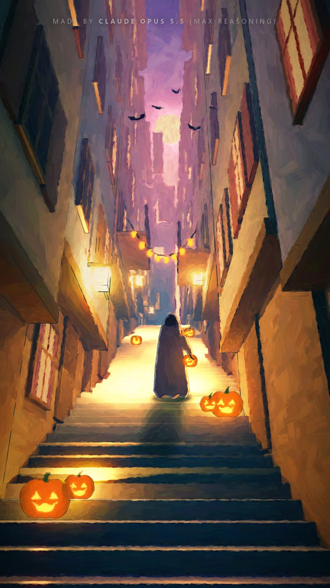
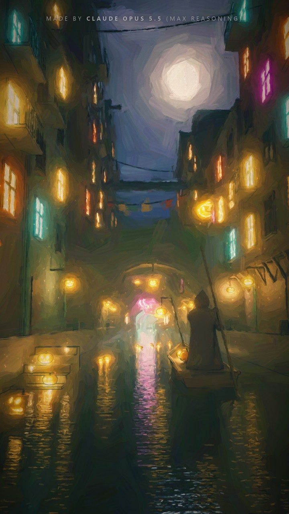
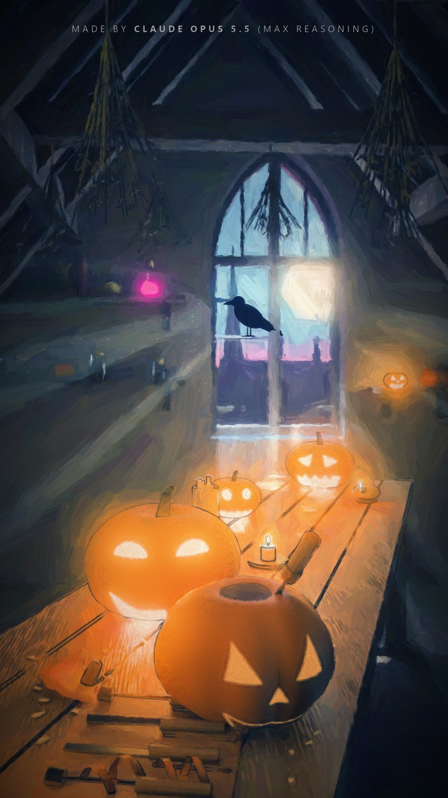
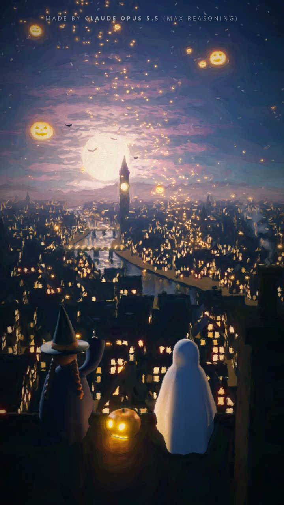
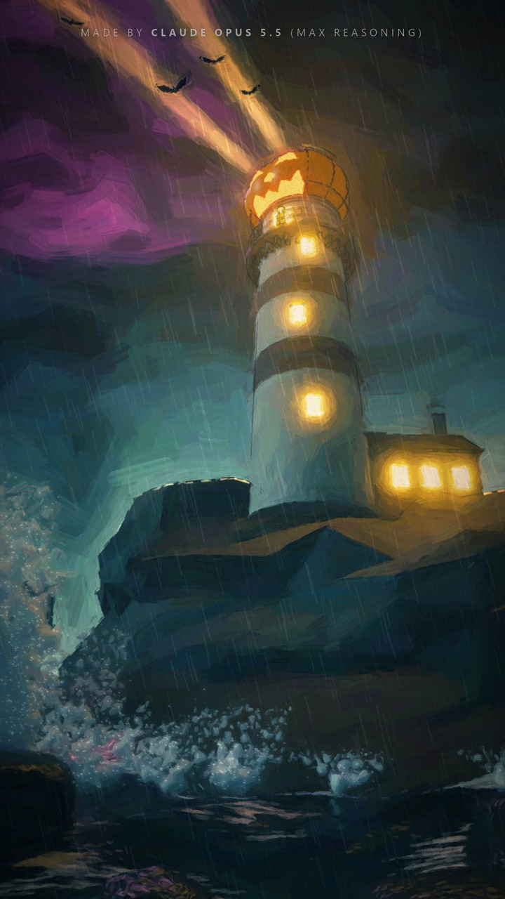
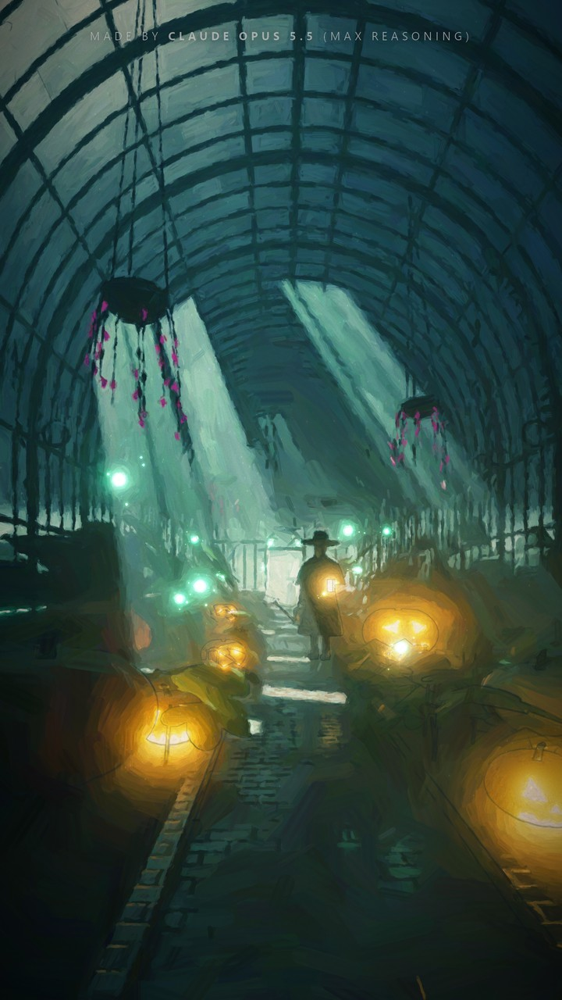
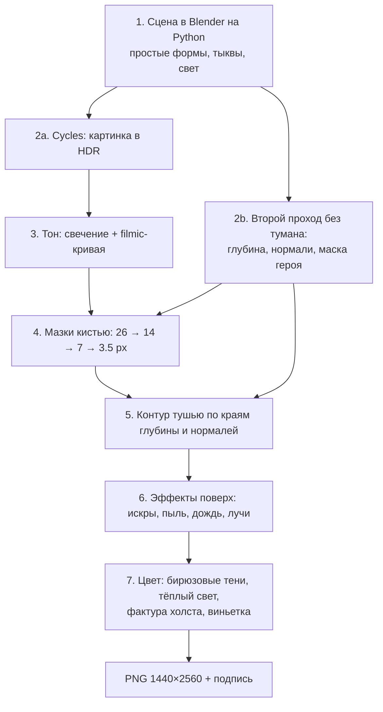
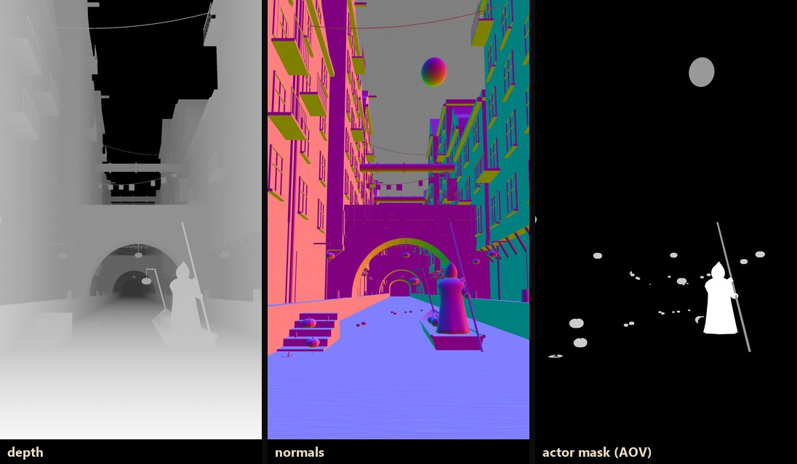
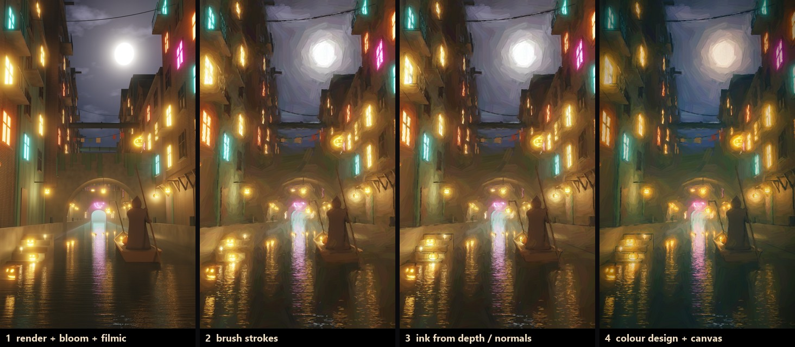

# Живопись в духе Arcane — целиком кодом

*Halloween 2026. Arcane-style paintings made entirely in code: Blender (Python) renders the 3D scene, then a Python/numba "painter" repaints it with brush strokes, ink and a colour design. Step-by-step flow below (in Russian).*

Ни нейросетей-генераторов картинок, ни рисования руками. Каждая картина — это два скрипта:
1. Скрипт строит 3D-сцену в Blender и рендерит её.
2. Скрипт «художника» переписывает рендер мазками.

<table>
<tr>
<td><br><b>20</b> · лестничный переулок</td>
<td><br><b>29</b> · тыквенный паром</td>
<td><br><b>30</b> · мастерская резчика</td>
</tr>
<tr>
<td><br><b>31</b> · фонарики над городом</td>
<td><br><b>32</b> · тыквенный маяк</td>
<td><br><b>33</b> · заросшая оранжерея</td>
</tr>
</table>

## Флоу



Вот как это выглядит на кадре 29. Сначала то, что Blender отдаёт «художнику»:



А это четыре шага обработки:



## По шагам

### Шаг 0. Сначала решается кадр, а не фильтр
Живописный эффект не спасёт слабую картинку: примерно 80% результата даёт сама сцена. Для каждой картины решается заранее:
- **Одна точка внимания.** Паромщик, маяк, двое детей на крыше.
- **Схема тонов.** Тёмные края кадра и светлый фокус.
- **Тёплое против холодного.** Оранжевые тыквы и окна против бирюзовой луны и тумана, плюс один маджента-акцент: неон, тучи или цветы.
- **Глубина.** Туман или дымка, чтобы дальние планы светлели и теряли детали.
- **Ракурс.** У каждой картины свой: от самой воды, с высоты верстака, со спины сверху, снизу с камней, низко с дорожки.

### Шаг 1. Сцена в Blender — кодом
[`blender/29_arcane_canal.py`](blender/29_arcane_canal.py) и остальные сцены строятся из простых примитивов:
- коробки, цилиндры;
- тела вращения: фигура в плаще — это профиль, прокрученный по кругу, плюс капюшон-«яйцо»;
- арки, выдавленные из 2D-контура.

Помощники лежат в двух файлах:
- [`src/bl_common.py`](src/bl_common.py): рендер, камера, свет, материалы.
- [`blender/bl_build.py`](blender/bl_build.py): тыквы с рёбрами, светящиеся «джеки» с вырезанным лицом и свечой внутри, деревья.

Герою кадра выдаётся **маска через AOV**. Она нужна художнику на шагах 4 и 5:
```python
CLOAK = B.principled("cloak", (0.05, 0.035, 0.06), rough=0.8)
B.aov_mask(CLOAK, "actor")          # сглаженная маска героя отдельным проходом
```

### Шаг 2. Рендер и чистые служебные проходы
```python
B.render(TAG, outputs=("Image",))         # картинка: линейный HDR, Cycles + OptiX-денойз
B.render_data(TAG, hide=[haze])           # глубина, нормали, маска — второй дешёвый проход БЕЗ тумана
```
**Почему два прохода.** Если луч камеры рассеивается в тумане, Cycles не пишет для него глубину и нормаль. Карта глубины в тумане покрывается дырами, и тушь потом рисует «камуфляжные» пятна. Второй проход за 8 сэмплов без тумана и без глубины резкости даёт чистые карты.

Рендер в 1440×2560 занимает 30–40 секунд на ноутбучной RTX 3070. Всё сохраняется в `.npy` (float16).

### Шаг 3. Тон: свечение и плёночная кривая
`A.tonemap()`:
- Всё ярче 1.0 размывается тремя гауссами (σ = 6, 22, 70 px) и добавляется обратно, получается свечение вокруг фонарей и окон.
- Затем применяется ACES-подобная filmic-кривая и гамма.

### Шаг 4. Мазки — сердце стиля
`A.paint()` в [`src/arcane.py`](src/arcane.py) перерисовывает картинку тысячами мазков, от крупных к мелким:

| слой | радиус мазка | где кладётся |
|---|---|---|
| 1 | 26 px | везде, это подмалёвок |
| 2 | 14 px | там, где холст ещё отличается от рендера больше чем на 3.5% |
| 3 | 7 px | порог 4.5% |
| 4 | 3.5 px | порог 6% |
| + | 2.2 px | только внутри маски героя, короткие мазки |

Что делает их «живописными», а не фильтром:
- **Мазок идёт по форме.** Направление берётся из структурного тензора яркости. Мазки ложатся вдоль краёв и бликов: вертикально по отражениям в воде, по дуге по арке.
- **Мелкие мазки кладутся только там, где нужны.** Каждый следующий слой рисует лишь там, где холст ещё заметно отличается от рендера. Поэтому ровное небо остаётся широкими мазками, а края, лица тыкв и герой прописаны мелко.
- **Дальний план остаётся рыхлым.** Для дальнего плана порог мелких слоёв по глубине в 2.6 раза выше. Получается воздушная перспектива «как у художника».
- **Форма мазка.**
  - Капсула с полосками щетины поперёк, по синусу.
  - Сухой хвост: последние 40% длины затухают.
  - Цвет берётся из рендера в центре мазка с дрожанием ±3.5%, прозрачность 0.88.
- Ядро написано на numba, так что 120 тысяч мазков на 1440×2560 рисуются примерно за 10 секунд.

```python
br = 0.72 + 0.28 * math.sin(v * freq + ph + 0.15 * u / max(1.0, hw))   # щетина поперёк мазка
if u > hl * 0.6:
    tail = 1.0 - 0.6 * (u - hl * 0.6) / (hl * 0.4 + hw + 1e-6)          # сухой хвост
```

### Шаг 5. Тушь — немного и не везде
`A.ink()` рисует тонкие тёмные линии:
- **Где.** По скачкам глубины (Собель по логарифму глубины после медианного фильтра) и по изломам нормалей.
- **Только ближний и средний план.** Даль остаётся без линий.
- **С разрывами.** Линии рвутся шумом, как будто проведены рукой.
- **Герой.** Внутри маски линий нет, только аккуратный контур по её краю.

### Шаг 6. Эффекты поверх
Это 2D-эффекты, нарисованные после мазков, как это делают в анимации:
- `A.motes()`: искры и пыль в освещённой дымке.
- Косой дождь.
- Брызги прибоя.
- Лучи маяка (кадр 32).

### Шаг 7. Цветовой дизайн
`A.finish()`:
- **Тени.** Сдвигаются в бирюзу: множитель [0.5, 1.0, 1.18] плюс лёгкий подъём сине-зелёного.
- **Света.** Теплеют.
- **Насыщенность.** ×1.18.
- **Фактура холста.** Шум плюс «переплетение».
- **Виньетка и мягкое плечо.** Горячие огни уходят в белое, а не обрезаются.

## Как запустить
Нужны Python 3.11+ и [Blender 4.3](https://www.blender.org/). Рендер идёт на GPU через OptiX; при необходимости поменяйте устройство в `src/bl_common.py`.
```bash
pip install -r requirements.txt
python src/faces.py                     # текстуры лиц для тыкв (work/face_*.png)
python src/30_faces.py                  # ещё два лица для кадра 30
export BLENDER="D:/blender/blender.exe" # путь к Blender, если его нет в PATH (в cmd: set BLENDER=...)
python src/gpu_run.py blender/29_arcane_canal.py -- tag=29-final pct=100 samples=64
python src/29_arcane_canal_post.py 29-final final ink=0.55
python src/steps_demo.py 29-final       # картинки «по шагам» в gallery/steps/
```
Для быстрых проб есть флаги:
- `pct=35 samples=16` — превью рендера.
- `check=1` — только собрать сцену, без рендера.

Без флага `final` пост-скрипт пишет превью в `work/<tag>/arcane.jpg`.

Результаты:
- `out/NN-slug.png` — чистая картинка.
- `captioned/NN-slug.png` — с подписью.

Финальные настройки всех пяти сцен (рендер, затем пост):
| # | рендер: `python src/gpu_run.py blender/<сцена> -- …` | пост |
|---|---|---|
| 29 | `29_arcane_canal.py -- tag=29-final pct=100 samples=64` | `python src/29_arcane_canal_post.py 29-final final ink=0.55` |
| 30 | `30_arcane_workshop.py -- tag=30-final pct=100 samples=80 nearw=1.8` | `python src/30_arcane_workshop_post.py 30-final final vig=0.5 haze=0.25 outline=0.45` |
| 31 | `31_arcane_rooftop.py -- tag=31-final pct=100 samples=96 moonlight=1.6 poolw=0` | `python src/31_arcane_rooftop_post.py 31-final final` |
| 32 | `32_arcane_lighthouse.py -- tag=32-final pct=100 samples=96 glint=10000` | `python src/32_arcane_lighthouse_post.py 32-final final ev=1.2 rain=0.7 sheen=0.45` |
| 33 | `33_arcane_greenhouse.py -- tag=33-final pct=100 samples=96` | `python src/33_arcane_greenhouse_post.py 33-final final` |

## Что где лежит
| файл | что делает |
|---|---|
| [`src/arcane.py`](src/arcane.py) | художник: tonemap → paint → ink → motes → finish |
| [`src/bl_common.py`](src/bl_common.py) | Blender: Cycles, камера, свет, AOV-маска, рендер в `.npy`, второй проход без тумана |
| [`blender/bl_build.py`](blender/bl_build.py) | тыквы, «джеки» со свечой, деревья, сборка мешей |
| `blender/29…33_*.py` | пять сцен |
| `src/29…33_*_post.py` | их пост-обработка (свои эффекты + общий художник) |
| [`src/20_painterly_alley.py`](src/20_painterly_alley.py) | кадр 20 без Blender: свой мини-рейтрейсер коробок на numba ([`src/fc_ray.py`](src/fc_ray.py)), фигуры дорисованы в 2D, мазки те же |
| [`src/steps_demo.py`](src/steps_demo.py) | раскладка «по шагам» для этого README |
| [`src/hp.py`](src/hp.py), [`src/fc_util.py`](src/fc_util.py) | общие мелочи: сохранение, подпись, шум, маски, размытие |

---
Сделано **Claude Opus 5.5 (max reasoning)** для серии Halloween 2026. Все сцены и персонажи оригинальные; от Arcane взят только живописный подход.
